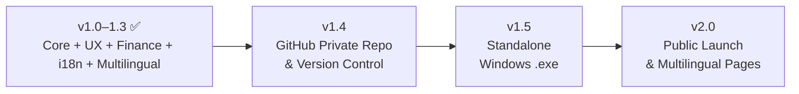

# PrivacyShield AI — Versioned Release Roadmap

Below is the milestone roadmap structured by semantic version numbers, mapping each feature to a logical release cycle.

---

---

## 📌 Release Milestones & Version Breakdown

### [v1.0.0] — Foundation & Core Desktop App *(Completed ✅)*
- [x] Electron + React 19 + Tailwind CSS desktop interface.
- [x] 100% local Python NLP sidecar engine (`spaCy` + Microsoft `Presidio`).
- [x] French & English basic detection: Person names, Organizations, Physical addresses, Emails, Phone numbers.
- [x] Bi-directional replacement & reversible restoration from external AI responses.
- [x] Active Mapping Vault side-panel with manual addition form.
- [x] One-click clipboard copy actions and session reset.

---

### [v1.1.0] — Interactive Selection & Precision Entity Editing *(Completed ✅)*
> **Focus**: Fixing false positives, edge-cases, and fine-tuning entity boundaries.
- [x] **Text Selection Context Menu**: Select any word → floating quick-action menu (Person, Company, Address, Custom).
- [x] **Inline Entity Boundary Editing**: Edit entity text directly in the mapping table; smart honorific prefix trimmer.
- [x] **Highlight Sync**: Hover over an entity card → animated cyan highlight synced to the input text area.

---

### [v1.2.0] — Finance/Legal Detectors & Full GUI Internationalization *(Completed ✅)*
> **Focus**: Business & compliance use-cases + multi-lingual desktop UI.
- [x] **Settings Modal**: Dedicated configuration panel for categories and preferences.
- [x] **Financial & Legal Detection Presets**: SIREN/SIRET, IBAN, NIR (Sécurité Sociale), Credit Cards, VAT/TVA.
- [x] **GUI i18n**: Full FR/EN translations with instant live language switching.

---

### [v1.3.0] — Dynamic NLP Language Engine Management *(Completed ✅)*
> **Focus**: Expanding beyond French & English to global multilingual NLP.
- [x] **NLP Language Model Manager** in Settings: install spaCy models for DE, ES, IT on demand with 1-click.
- [x] **Per-Document Language Override**: NLP selector dynamically shows installed languages with flag emojis.

---

### [v1.4.0] — Private GitHub Repository & Version Control *(Completed ✅)*
> **Focus**: Safe, versioned development workflow before distributing to users.
- [x] **Git Initialization**: Clean commit history, production `.gitignore` filtering out virtualenvs, node_modules, build artifacts.
- [x] **Private GitHub Remote**: Hosted securely at [`https://github.com/Galdeano/PrivacyShield-AI`](https://github.com/Galdeano/PrivacyShield-AI).
- [x] **Branch Strategy**: `main` (stable production) + `dev` (active development) branches established and pushed.
- [x] **BSL 1.1 License**: Formalized with David Galdeano copyright, personal/non-commercial grants, commercial license requirement for businesses, auto-converting to MIT on Jan 1, 2030.
- [x] **Changelog & CI**: Added `CHANGELOG.md` and automated GitHub Actions workflow (`.github/workflows/ci.yml`).

---

### [v1.5.0] — Standalone Windows Executable (.exe)
> **Focus**: Zero-dependency distribution for non-technical users.
- [ ] **Embedded Python Engine**: Freeze Python engine + spaCy models into a portable runtime via PyInstaller (no Python install required).
- [ ] **Single-File NSIS Windows Installer**:
  - Setup installer: `PrivacyShield-Setup-1.5.0.exe`
  - Portable executable: `PrivacyShield-1.5.0-Portable.exe`
- [ ] **App Icon Branding**: Custom `.ico` file for taskbar and installer.
- [ ] **Auto-update Hook**: Check GitHub Releases for new versions on startup.

---

### [v2.0.0] — Public GitHub Launch & Multilingual Promotional Showcase
> **Focus**: Go public, build community, multilingual marketing presence.
- [ ] **Make Repository Public**: Switch from private to public + add open source license.
- [ ] **GitHub Release**: Tag v2.0.0, attach signed `.exe` installer and portable binary.
- [ ] **`CONTRIBUTING.md`** and Issue / PR templates for community.
- [ ] **GitHub Actions CD**: Automated builds and release uploads on new version tags.
- [ ] **Multilingual Promotional Landing Pages (GitHub Pages)**:
  - One page per supported language:
    - 🇫🇷 `/fr` — French landing page (primary target audience)
    - 🇬🇧 `/en` — English landing page
    - 🇩🇪 `/de` — German (once DE NLP model validated)
    - 🇪🇸 `/es` — Spanish
    - 🇮🇹 `/it` — Italian
  - Each page includes: hero banner, interactive before/after demo, privacy manifesto, OS-specific download buttons.
  - Language auto-detection via browser `Accept-Language` header with manual switcher.

---

## ⚖️ Licensing & Monetization Analysis

### Should You Sell This?

**Short answer: Yes — but the model matters a lot.**

Here is a comparison of the main strategies:

| Model | Mechanism | Pros | Cons |
|:--|:--|:--|:--|
| **Source-Available / BSL** | Public code, free personal use; paid commercial license | Full control, deters competitors, generates revenue | Smaller community, trust barrier |
| **Freemium + Pro** | Free core desktop app; paid "Pro" tier (team sync, cloud vault, advanced models) | Broad adoption first, sustainable SaaS revenue | Requires backend infra for Pro features |
| **One-Time Purchase** | Sell the `.exe` via Gumroad / Paddle | Simple, no subscription fatigue | No recurring revenue, support burden |
| **Dual License (GPL + Commercial)** | Free for open-source projects; paid for commercial use | Standard model (like Qt, MySQL) | Complex legal communication |
| **MIT / Apache (fully open)** | Free forever, all uses | Maximum adoption, community trust | No direct revenue; monetize via consulting |

### My Recommendation for PrivacyShield AI:

> **Source-Available now → Freemium + Pro later**

1. **Start with a private repo** (v1.4) under no license (all rights reserved by default) while you finalize the product.
2. **At v2.0 public launch**: release under a **Business Source License (BSL 1.1)** or **Custom RAIL License**:
   - Free for personal, non-commercial, and open-source use.
   - Requires a paid commercial license for companies or teams using it in a business context.
3. **Future Pro tier** could add:
   - Team session sharing (encrypted vault sync).
   - Audit log export for GDPR compliance officers.
   - API mode (pipe text through PrivacyShield before it reaches OpenAI API calls).
   - Integrations: Outlook plugin, VS Code extension.

This app solves a **real compliance pain point for businesses** (law firms, consulting, HR, finance) — the commercial licensing potential is genuine.
